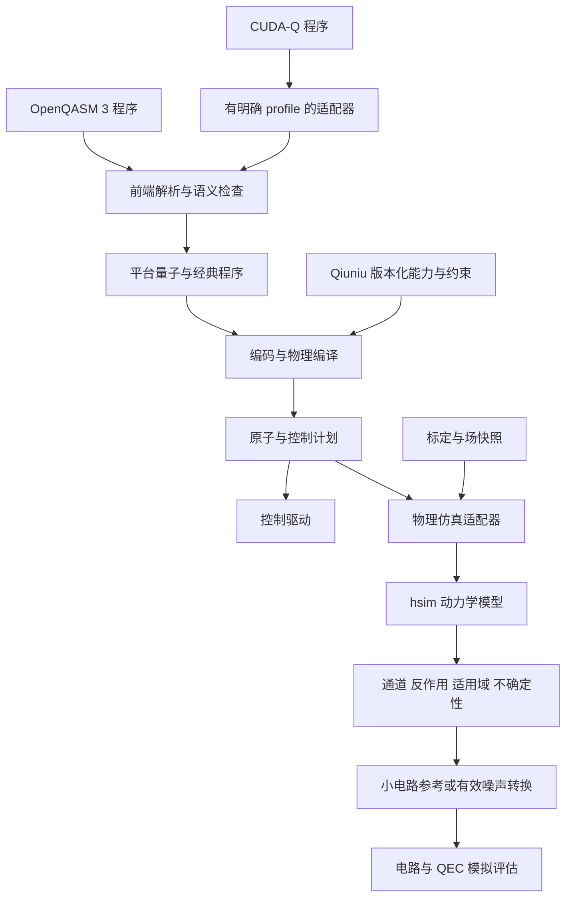

# hsim AQCIS 与电路格式的接入评估

日期：2026-10-19。状态：源码调研与架构建议，供 Claude 审查；不表示 D1–D7 已确认，也不表示适配器已实现。

定位：OpenQASM/CUDA-Q 提供程序表达与互操作入口，AQCIS 提供 Qiuniu 设备的指令语义与能力约束，hsim-aqc 提供操作级物理动力学、噪声与反作用。三者应接在不同端口，共享身份、时间、单位和版本协议。

## 1. 核查来源和范围

| 来源 | 固定版本 | 本轮核查 |
|---|---|---|
| `zhang-wenjun/hsim-aqc`，Python 包名 `uftqc` | `8e71f80282e70fc03e771d3edee41a30dcb07dfa`，包版本 0.1.0 | README、物理输入/结果协议、Raman 标定接口、runner、采样、漂移及缓存实现与文档 |
| `uftaqc/aqcis` | `346997ae87f9827858507fcead6abc7c32698c87` | 用户指定的 `isa-qiuniu.typ`，以及同库 `isa-qiuniu-near-self-contained.typ` v0.2.1 |
| OpenQASM | 官方语言、语法与 Python `openqasm3` 包文档 | 外部格式与 parser/AST 的职责 |
| NVIDIA CUDA-Q | 2026-10-19 读取的官方 latest 文档 | Quake/CC/QEC 表示，Python API 导出格式 |

两库通过 Git 取得并固定上述提交；本轮没有安装依赖、执行动力学计算、运行其测试或连接设备。CUDA-Q latest 文档不是已经验证的本地依赖版本，接入试验还需固定发行版与具体功能集。

## 2. hsim 的已有能力和正确接入位置

源码主接口是 `OperationBackend.simulate(PhysicalParameters, target_unitary=...) → OperationResult`。`PhysicalParameters` 包含单次操作可见的场、激光、光阱与原子状态，排程、zone、长期标定历史由上层负责。[物理输入](https://github.com/zhang-wenjun/hsim-aqc/blob/8e71f80282e70fc03e771d3edee41a30dcb07dfa/src/uftqc/physical_state/context.py)；[后端协议](https://github.com/zhang-wenjun/hsim-aqc/blob/8e71f80282e70fc03e771d3edee41a30dcb07dfa/src/uftqc/operations/base.py)。

`OperationResult` 已提供量子作用、经典反作用、误差模型、持续时间、物理观测量、适用域、不确定性和来源。量子作用可为 unitary、Kraus 或 superoperator。因此应保留完整通道和反作用，不能只提取 `fidelity` 后换成一个统一退极化概率。[结果类型](https://github.com/zhang-wenjun/hsim-aqc/blob/8e71f80282e70fc03e771d3edee41a30dcb07dfa/src/uftqc/operations/result.py)。

已见实现包括 Raman、四能级 Rydberg CZ 及开放系统模型、AOD 经典输运、XY8 与输运耦合、小电路密度矩阵传播，以及 shot/ensemble 采样。各模型接入的物理量与假设不同，不能因输入对象中有温度/激光字段就认为所有后端已使用它们。[项目说明](https://github.com/zhang-wenjun/hsim-aqc/blob/8e71f80282e70fc03e771d3edee41a30dcb07dfa/README.md)。

关于“标定真实实验噪声”，当前更准确的结论是：**已经支持用标定参数驱动物理预测；完整的数据反演、参数辨识和独立实验验证流程尚未在本轮查看的源码中建立。** `RamanAtomicCalibration` 接受同一工作点测得的 Rabi、差分光移和散射率；示例明确其数值只是 illustrative，需要换成实测值。优化脉冲或拟合模拟条纹也不等于从实验数据完成噪声辨识。[标定接口说明](https://github.com/zhang-wenjun/hsim-aqc/blob/8e71f80282e70fc03e771d3edee41a30dcb07dfa/docs/raman_adiabatic_backend.md)；[示例](https://github.com/zhang-wenjun/hsim-aqc/blob/8e71f80282e70fc03e771d3edee41a30dcb07dfa/examples/03_measured_raman_x.py)。

建议分开三个职责：

- `CalibrationService`：测量数据、实验条件、拟合参数、协方差/不确定度、有效期与留出验证；可调用物理模型做拟合。
- `PhysicsBackend`：以冻结参数和具体操作求动力学、通道与反作用；由 hsim 适配器承担首个实现。
- `NoiseReduction`：为大规模电路/QEC 生成可计算的近似模型，显式记录 Pauli 化、局域化、Markov 化或查表误差及适用范围。

密度矩阵参考适合小系统校验。扩展到大规模 QEC 应采用分层方法：精细物理模型 → 经验证的有效通道/相关噪声模型 → 电路/QEC 模拟，而不是承诺对整个处理器一直做精细密度矩阵积分。

需要在适配器中处理的边界：

| 边界 | 源码事实与设计要求 |
|---|---|
| 调度 | `CircuitRunner` 按层内顺序执行，layer 不是物理并行保证。全局调度仍由平台承担 |
| 场与漂移 | 当前源码已有 `LayerFieldSchedule` 和 ensemble 场采样；旧 physical-circuit 文档的“无漂移/无采样”段落不能概括整个最新包 |
| 回馈 | 当前请求核心是目标幺正与动力学后端，尚未见通用中途测量/经典条件操作契约；不能直接承诺完整动态 QEC executor |
| 分支反作用 | 当前 `QuantumInstrument` 只有一份公共 back action；分支相关反冲、泄漏和 loss 的联合模型需要扩展契约 |
| 可观测性 | Kraus 分解不唯一；内部 sampled branch 不自动等于实验可测事件，策略不能读取未被设备观测到的“真值” |
| 概率 | 计算子空间外概率、原子物理丢失和实验检测到的 loss 分别记录，不能相互替代 |
| 单位/序 | 适配 s/m/Hz 与平台单位，明确角频率约定、原子目标顺序与张量顺序；hsim 输出首原子为最高位 |
| 缓存 | hsim 有容差量化缓存，属于近似复用；量化规则及误差验证进入 provenance，不能冒充精确内容相等 |

这些限制见 [runner 源码](https://github.com/zhang-wenjun/hsim-aqc/blob/8e71f80282e70fc03e771d3edee41a30dcb07dfa/src/uftqc/physical_circuit/runner.py)、[采样语义](https://github.com/zhang-wenjun/hsim-aqc/blob/8e71f80282e70fc03e771d3edee41a30dcb07dfa/docs/experiment_sampling.md)、[漂移文档](https://github.com/zhang-wenjun/hsim-aqc/blob/8e71f80282e70fc03e771d3edee41a30dcb07dfa/docs/long_drift_fields.md) 和 [缓存契约](https://github.com/zhang-wenjun/hsim-aqc/blob/8e71f80282e70fc03e771d3edee41a30dcb07dfa/docs/backend_execution_and_cache.md)。

## 3. AQCIS 的定位与版本差异

AQCIS 全称为 Instruction Set Architecture for Atom Quantum Computation。核查提交只有 README、两份 Typst 文档和一份 PDF；它提供设备 ISA/操作语义说明，可作为 DeviceProfile 与设备方言的依据，尚不是现成的可执行 IR 库、解析器或控制驱动。

用户指定的 [isa-qiuniu.typ](https://github.com/uftaqc/aqcis/blob/346997ae87f9827858507fcead6abc7c32698c87/isa-qiuniu.typ) 同时讨论硬件基本操作、抽象操作与近期限制；其中泛化描述允许利用测量结果控制未来操作，近期部分则只允许终端测量。这些 profile 不能混合使用。

同库的 [near-self-contained v0.2.1](https://github.com/uftaqc/aqcis/blob/346997ae87f9827858507fcead6abc7c32698c87/isa-qiuniu-near-self-contained.typ) 给出更明确的近期能力，以及脉冲级 Hamiltonian、控制参数和操作成本估计：

- 静态/移动阱分开维护占用；同一抽象格点可分别容纳一个静态阱原子和一个移动阱原子。
- 近期移动模型采用固定等间距矩形移动阵列和整体平移；load/move/unload 构成周期。
- 1Q/2Q/measurement zone 的作用范围是原生操作语义的一部分。zone 可重叠、同种功能可有多个 zone，电路期间位置配置不变。
- 1Q 门为 zone 内广播的 `R_phi(theta)` 与相位门，2Q 为 zone 内满足双占用条件的 CPHASE。
- 测量只在整个电路末端进行；这不能直接承载需要中途综合征读出、辅助位复用和反馈的目标协议。
- 单列的 Hamiltonian/pulse 描述支持模拟模式；其中量子态基底含义与数字门模式需要在适配前分别确认。

由此建议增加具名 profile，例如 `qiuniu.near-term/0.2.1`，明确 `mid_circuit_measurement=false`、`in_circuit_feedback=false`，只声明已说明的操作。面向未来动态 QEC 的模拟 profile 另行标识，不把未来能力写入当前硬件 profile。

两个需要请设备规范作者确认的具体问题：

1. **卸载坐标。** v0.2.1 第 295–302 行的终点占用检查使用 `x_1(T), y_1(T)`，随后卸载更新却使用 `x_1(0), y_1(0)`。非闭合路径下应使用哪个位置，需要澄清后再实现，不能静默修订为自选语义。
2. **双比特门附加相位。** 原 `isa-qiuniu.typ` 的 self-contained 部分含 `CPHASE(theta) Z(beta(theta))`，并说明 spectator 单原子也受到 Z 相位；v0.2.1 第 366–370 行注明从 0.1.1 起按实验侧消除此相位的约定移除该项。适配器需绑定相位补偿约定与设备版本，避免漏补偿或重复补偿。

抽象格点的“双占用”不能直接翻译成两个点粒子在连续坐标完全重合。`SiteId`、trap 种类和实际 trap/atom 坐标需分离，由设备 profile 给出几何语义。表格中的近似时间/保真度也只作为规范估计，不能直接升级为实验标定快照。

## 4. OpenQASM 与 NVIDIA 的兼容范围

OpenQASM 是语言与交换格式；Python `openqasm3` 提供 AST、parser 和 visitor。解析成功只说明语法可以接受，不能证明设备可执行、类型/作用域正确或量子语义已经验证。[官方语言](https://openqasm.com/language/index.html)；[语法的职责](https://openqasm.com/versions/3.1/grammar/index.html)；[Python 包](https://pypi.org/project/openqasm3/)。

建议第一阶段支持明确的 OpenQASM 3 输入 profile：固定寄存器、标准门与参数表达式、reset、measurement、简单条件及有界循环。为位序、测量到条件的依赖和参数绑定建立一致性测试；timing、defcal、extern 与动态分配分别协商支持。OpenQASM 3 确实可表达 timing/calibration 内容，但通用语法不自动定义本平台的 AOD、zone 与资源租约语义。[脉冲/校准扩展](https://openqasm.com/language/pulses.html)。

当前本项目 `develop@9f4d9bd` 的 `src/na_pipeline/frontend/qasm.py` 明确为 export-only，不能将已有导出函数算作新架构的导入兼容。

NVIDIA 需区分：

- **CUDA-Q**：量子/经典混合编程与执行工具链；当前编译文档中 Quake 表达量子操作，CC 保留经典控制，QEC dialect 表达测量的 detector/observable 奇偶关系。值得参考它们共享模块但保持语义边界的设计。[编译 IR 文档](https://nvidia.github.io/cuda-quantum/latest/using/extending/compiler/cudaq_ir.html)
- **cuQuantum**：仿真加速库，可作为后端计算设施；它不是客户电路交换格式。[官方介绍](https://developer.nvidia.com/cuquantum-sdk)

CUDA-Q Python 文档中 `cudaq.translate` 列出的格式包括 QIR 系列和 OpenQASM 2，没有列出通用 OpenQASM 3 导出。不能承诺任意动态 CUDA-Q kernel 都能无损经 QASM2 导入平台。[Python API](https://nvidia.github.io/cuda-quantum/latest/api/languages/python_api.html#cudaq.translate)

兼容按方向拆开验收：OpenQASM 导入、平台程序导出、平台程序执行于 CUDA-Q、外部 CUDA-Q kernel 导入，是四项不同能力。建议先做 OpenQASM 3 的受限双向转换与平台到 CUDA-Q 的小电路执行，再评估基于 Quake/QIR 的外部 kernel 导入；不预先绑定未验证的内部 MLIR ABI。

## 5. 建议的跨层关系

这是建议的数据流，箭头不代表当前已经存在转换器。数字门、模拟 Hamiltonian 和原子动作的语义需要分别保持；不强迫所有模拟模式绕行数字门编译。

## 6. 建议交给 Claude 的阶段任务输入

| 顺序 | 设计/实现任务 | 明确验收 |
|---|---|---|
| A | 冻结外部依赖提交和 profile；澄清 Qiuniu 卸载坐标、相位及 measurement 能力 | 能力表、语义问题结论、输入输出样例，不先写模糊驱动 |
| B | hsim 操作级适配器 | 单位/目标序转换，小门通道一致性，反作用接续，来源与适用域保存；依赖在隔离环境验证 |
| C | OpenQASM 3 受限前端 | 参数/测量/位序/条件 round-trip；不支持语法有诊断；不能用静态 trace 代替动态程序 |
| D | Qiuniu 设备方言与 verifier | load–translate–unload 守恒，空 trap 不生成原子，zone 广播，能力不支持时拒绝 |
| E | CUDA-Q 受限互操作 | 用非对称输入和受控门核对位序，保留测量输出；明确支持的目标与格式版本 |
| F | 分层噪声与 QEC 评估 | 精细模型和近似模型对照，报告相干/相关/泄漏处理与误差；拒绝将终端测量硬件标为动态 QEC 兼容 |

外部库升级需要在适配器边界执行符合性测试，不通过修改平台核心字段来追随每次第三方 API 变化。实际任务范围由确认后的 D1–D7 与 Claude 的阶段说明确定。
