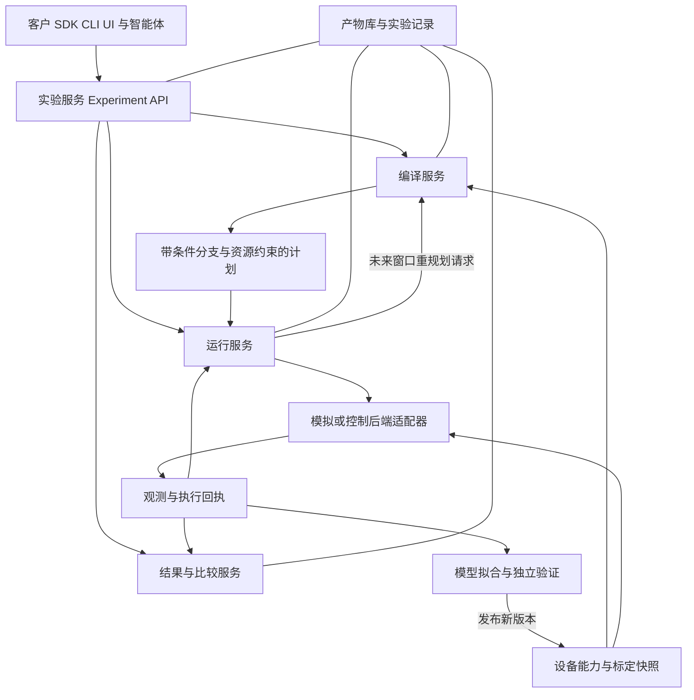

# 中性原子全栈软件的系统边界与重构设计

日期：2026-10-19。状态：设计提案，接口尚未冻结。代码基线：`develop@9f4d9bdad91976524d0353b4d3661b4b92e93072`。

目标是让客户通过稳定的实验接口使用中性原子计算机，让研究者和智能体能够替换编译、纠错、模拟与控制策略，并用同一套实验定义比较结果。最终的 digital twin 必须通过设备数据验证模型的适用范围，不能仅由动画连贯或软件接口一致来认定。

本文接续输入的 `architecture-v2.md` 与 `engineering-workflow.md`。保留分层 IR、插件、独立验证、不可变产物和渐进迁移方向，修订其中影响长期扩展的假设。工程落地见 [测试、回退与发布](engineering-workflow.md)，本轮核查见 [基线审计](baseline-2026-10-19.md)。

## 1. 产品应当提供什么

| 使用者 | 需要完成的工作 | 稳定入口与验收结果 |
|---|---|---|
| 客户 | 提交程序，选择设备与执行模式，查看成本和结果，取消任务 | `ExperimentSpec → CompileReport → RunHandle → ResultBundle`；不需要知道内部路由器 |
| QEC 研究者 | 换码、综合征电路、解码器、loss 策略，比较逻辑性能 | 相同实验定义、噪声假设与统计口径下的比较报告 |
| 控制工程师 | 导入设备能力与标定，接入控制器，解释失败 | 设备与控制协议、时钟映射、命令回执、硬件在环测试 |
| 方法开发者 | 替换布局、路由、调度或联合求解器 | 能力声明、输入输出契约、符合性测试、独立验证与预算 |
| 智能体 | 提出候选方案，执行有限实验，比较结果并保存证据 | 可查询的实验 API、运行预算、取消与恢复、可复现的候选记录 |

第一版交付范围是本地可安装的软件与模拟实验闭环。云端多租户、计费和大规模服务部署可后续实现，但任务身份、配额、数据归属和执行权限应在接口中留有明确位置。

数字门与 QEC 是首条主线；模拟量子计算可以在未来作为独立程序方言进入。不能让模拟 Hamiltonian 程序为了复用接口而伪装成 Clifford 电路。

## 2. 对两份草案的关键修订

| 原设想 | 修订 | 原因 |
|---|---|---|
| Physical IR 与 Stim 一一对应 | 自有物理操作语义；Stim 是受限稳定子视图与适配器 | 非 Clifford、通用经典分支及非 Pauli 噪声不能无损落入 `stim.Circuit` |
| `HERALDED_ERASE` 表示全部 atom loss | 区分物理丢失、观测到丢失、量子擦除模型及补载 | 丢失会改变占用与后续相互作用，擦除通道本身没有这些空间与控制语义 |
| `EvidenceLevel` 线性排序，输出取输入最小值 | 分离执行种类、模型范围、验证声明和来源 | 理想态矢量结果不一定比带标定的稳定子模型更适用；计划被真实执行后可以产生新的硬件证据 |
| 同一 Executable 可直接切换所有后端 | 同一实验语义与兼容计划，经过能力检查产生各后端执行映像 | 脉冲后端与电路模拟器不能普遍消费同一二进制或支持同一分支 |
| 离线确定、在线随机 | 离线规划与受时限约束的在线控制 | 编译器也可能随机搜索；运行时也可能执行确定控制。关键是信息何时可用以及控制期限 |
| 运行时动态到 P5 再做 | 第一条闭环即定义提交边界、回执、状态版本、取消和恢复 | 否则会再次把动态能力补丁式接入静态流水线 |
| 所有层按单链 import | 领域模型和端口分离，组合根连接服务与适配器 | 物理门定义不应依赖码实现；运行时不应直接 import 编译算法 |
| 先完成所有底层类，再使用它们 | 先定底层不变量，再用最小纵向切片验证必要抽象 | 避免创建大量没有实际消费者的框架类 |

这里的取舍是本项目的设计判断；业界资料支持相关机制，不代表它们采用了本项目的全部设计。

## 3. 系统组成与依赖方向

采用模块化单体起步，保留可进程隔离的端口。可插拔不要求先拆微服务；远程执行、大型模拟器或控制桥接有实际需要时，再把对应适配器移到进程外。

图中的反馈是调用协议，不是包之间互相 import。建议按以下边界组织，具体目录在首个实现切片中验证：

| 包 | 负责 | 允许依赖 |
|---|---|---|
| `core` | 单位、身份、内容地址、错误与版本基础类型 | 标准库 |
| `models.device` | 能力、约束、标定元数据、模型参数 | core |
| `models.program` | 逻辑与物理操作、值、控制流、QEC 注解 | core；不得依赖码或后端实现 |
| `models.plan` | 原子动作、轨迹、资源区间、源映射 | core、device、program 的类型 |
| `models.execution` | 命令、观测、回执、运行状态投影 | core、plan 的引用类型 |
| `ports` | 编译、执行、解码、产物存储等协议 | models、core |
| `verify` | 结构、语义、几何、时序和执行记录检查 | models、core；不调用被检算法 |
| `services` | 实验、编译、运行、评估用例的编排 | ports、models、verify |
| `plugins` | 码与 gadget、求解器、模拟器、驱动、存储实现 | 公开 ports/models 与各自可选依赖 |
| `bootstrap` 与应用入口 | 发现插件、解析配置、注入具体实现 | 以上组件 |

`core` 不收纳所有协议。设备不认识 Surface-17，通用运行服务不认识 Enola；适配器把已有库的概念翻译为端口契约。依赖方向通过静态 import 约束和包安装测试检查。

## 4. 最底层首先固定的语义

1. **身份。** `AtomId` 是载体，`SiteId` 是空间位置，`PhysicalQubitId` 是计算角色，`CodeBlockId` 与 `LogicalQubitId` 是编码与应用身份；映射随时间和 epoch 改变。补载新原子不能沿用旧载体的量子状态或租约。
2. **时间。** 区分计划时间、设备发生时间、观测可用时间和服务接收时间。设备时钟有分辨率、同步误差和 clock domain；统一单位不代表已经同步。反馈只能使用已发布且属于当前 epoch 的观测。
3. **状态。** 计划预测、运行时已知状态、模拟器内部真实状态分别保存。策略只能看到其观测权限内的信息；未知占用与未知 loss 不能默认为无 loss。量子态保存在模拟后端，不能混入通用 WorldState。
4. **不可变性。** 编译产物、设备快照与已提交记录不可修改；会话通过受控事务更新状态。`frozen=True` 不保证嵌套 dict 不可变，序列化与哈希也必须规范化。
5. **不确定性。** `unsupported`、`unknown`、`budget_exhausted`、`infeasible` 和执行失败分别编码。只有有依据的不可行结论才能返回 `infeasible`；搜索超时不能当成证明。
6. **信息与副作用。** 每个操作声明读取、写入、消耗的资源与经典值；lowering 保留因果关系、测量映射与条件语义。几何可行不等于量子语义正确。

## 5. 设备与 digital twin

将大一统 DeviceModel 拆为可关联而独立版本化的对象：

- `DeviceCapabilities`：支持的门、运动、测量、反馈、补载与控制粒度，以及资源拓扑和硬约束。
- `CalibrationSnapshot`：数值、单位、测量时间、有效期、实验条件、来源与不确定度；缺数据明确标记为 unknown。
- `NoiseModelSpec`：如何从标定与计划生成噪声，包括空闲、移动、串扰、成像、loss、相关性与历史依赖；模型名称不等于测得的事实。
- `ObservedDeviceState`：当前可观测占用、位置、健康状态、资源与版本；与静态规格分开。
- `ModelValidationReport`：留出实验、误差指标、置信区间、有效工作区间与失配记录。

孪生闭环是：实验记录 → 参数拟合 → 在独立数据上验证 → 发布新模型快照 → 对同一 ExperimentSpec 做预测 → 与新观测比较。拟合数据和验收数据需分开；漂移产生新版本，不追改历史结果。硬件随机实验不能承诺逐 bit 重现，离线回放只能重现已记录的因果过程。

因此第一版只能称为模型驱动的模拟平台；积累设备数据并通过上述闭环后，才有对应范围内的 digital twin 证据。

## 6. 程序与编译契约

保留多个语义层，但不是每个任务都必须走完六层：

`应用程序 → 逻辑程序 → 编码协议/gadget → 物理操作 → 原子计划 → 后端执行映像`。

客户可以从逻辑层进入，实验工程师可从原子层进入；QEC memory 可以从编码层进入。每次进入都需要能力和前置条件检查。

`LogicalProgram` 保留量子与经典控制流；PBC 是其中一种有价值的规范化形式，不能成为所有前端必须接受的限制。`EncodedProgram` 关联码实例、gadget、测量语义与帧；`PhysicalProgram` 保留物理操作与可选的 detector/observable 注解。Stim 导入与导出只对声明支持的子集无损，其他内容给出拒绝或显式近似报告。

每个 pass 的完整契约为：输入/输出版本、需要的能力与分析、前置条件、保持或失效的性质、随机种子和预算、诊断信息、验证证据。随机搜索的配置与实现版本进入 provenance。`PassManager` 不负责证明 pass 自己声称的语义正确。

布局、路由和调度可以独立替换，也允许一个联合求解插件同时完成三者。稳定边界是 `PlanningProblem → PlanCandidate + ConstraintReport + CostEstimate`，不能强迫联合优化算法遵守固定的 place→route→schedule 内部实现。

`ConflictOracle` 返回带适用条件、状态版本与时限的约束摘要；启发式估计返回 unknown 时，调用者可以保守排队或继续求解。缓存键包含全部影响结果的依赖：输入、码与 gadget、能力和相关标定、噪声/目标函数、插件版本、配置、种子等。只缓存不可变编译结果，不缓存 live token、测量结果或运行资格。

## 7. 运行协议与状态所有权

最小后端协议应表达以下行为，而不止 `submit()` 与 `events()`：

| 调用 | 输入与输出 | 必须成立的语义 |
|---|---|---|
| `capabilities()` | 版本化能力声明 | 不支持的操作在提交前可诊断 |
| `prepare(plan, context)` | 执行映像与预检报告 | 不产生物理动作；验证设备、标定、资源和反馈能力 |
| `submit(image, idempotency_key)` | 稳定 run ID 与提交回执 | 网络重试不会无条件重复执行物理操作 |
| `observe(run, cursor)` | 有序记录、下一 cursor 与完整性标志 | 能去重、发现缺口并断线重连；不能只按到达时间排序 |
| `propose_update(run, expected_epoch, command)` | 接受、拒绝或待处理回执 | 明确提交前沿；已不可撤回的动作不能重写 |
| `cancel(run, mode)` | 取消请求与最终终态 | 请求取消不等于动作已经停止 |
| `reconcile(run)` | 后端实际状态及未知范围 | 断线后先核对，不能盲目重放不可逆动作 |

若控制系统不能提供持久幂等记录和状态核对，适配器必须将不确定提交暴露为 `outcome_unknown`，不能宣称 exactly-once。

`RuntimeSession` 是应用状态的单一提交者；策略返回命令建议，Broker 管理资源事务，后端报告设备事实。并行 executor、decoder、Broker 都可有内部状态，不能把“只有一个 WorldState”误解成整个系统只有一个可变对象。

记录至少包含 `run_id / event_id / sequence / epoch / command_id / caused_by / device_time / available_time / schema`。事件日志保存观测与回执，原始相机数据和大型波形以内容地址引用；状态投影支持重建。哈希链能检查完整性，不自动证明硬件真实性或持久化已经成功。

运行状态最少区分 `created → prepared → submitted → running → completed/failed/cancelled/outcome_unknown`，等待与背压作为运行子状态记录。重规划只能替换明确尚未承诺的窗口。物理失败后的恢复是停止、补偿或重建；Git 回退不能撤销物理动作。

硬实时反馈路径留在控制器、FPGA 或专用低延迟执行环境，包含预编译分支和必要解码。Python 服务承担较慢的重规划与协调；智能体搜索在实验之间执行。三个时间尺度必须分别声明 deadline、超时行为和可观测性。

## 8. QEC 的稳定抽象

`CodeDefinition` 给出生成元、逻辑算符及结构；码距可带已知值与依据，不能仅凭参数标签承诺实际电路距离。第一批支持稳定子/CSS 码，未来 subsystem 等扩展通过额外能力声明进入。

`GadgetSpec` 给出逻辑语义、码和设备前提、入口/出口布局要求、测量与 observable 映射、帧变换、资源、失败与 loss 行为。码、抽象 gadget、设备编译结果分别版本化。

`DecoderModel` 不局限为一个无条件 DEM：还应携带测量到 detector 的映射、逻辑 observable 映射、边界与时间窗口、erasure 信息、相关误差与近似声明。解码会话必须区分 shot/epoch、round、窗口结束与结果可用时限，返回带适用范围的 FrameUpdate。

后选择分别记录尝试数、接受数、拒绝/丢失数与接受条件下的性能，不能只报告被接受 shot 的成功率。多码块横向门和 surgery 可能需要联合解码；局部 hook 检查、无噪声正确性、单故障分析、完整电路级噪声实验是不同证据。

Stim 首先用于明确支持的 Clifford memory 和 QEC 子电路。其 `HERALDED_ERASE` 是带记录的量子擦除通道；从它生成 DEM 存在官方注明的近似。物理丢失造成的门缺失、延迟检测、误检、补载与重编码由设备模型和运行协议另行表达。完整非 Clifford Shor/魔态过程不能因为导出过部分 Stim 电路就声称已完成态模拟。[Stim 文档](https://github.com/quantumlib/Stim)；[擦除通道定义](https://github.com/quantumlib/Stim/blob/main/doc/gates.md#the-heralded_erase-instruction)。

## 9. 插件如何被真正替换

每个插件有 Manifest：标识/版本、协议版本范围、支持的 IR 与能力、前置条件、确定性、资源需求、配置 schema 和输出声明。发现成功不等于可以执行；装载前进行版本和能力协商。

符合性测试验证协议，领域测试验证方法。替换路由器时，客户程序和运行服务保持不变；候选计划经过相同的独立几何、时序、语义检查，再比较目标函数。更短的计划仍可能因误差、吞吐或失败率变差而不适用。

不支持的码结构、超时、依赖缺失、协议不兼容都要明确返回。回退策略必须可配置、可追踪，记录实际使用的算法；不得悄悄改用不同目标函数或放宽设备约束。

Enola、ONEX、ZAC 等先按照各自输入、限制与实现证据单独适配，不把它们预先承诺为相同功能的 router。插件是能力与语义契约，不是统一函数名。

## 10. 智能体探索是实验用例

智能体与客户共享 `ExperimentSpec` 和结果查询入口。`SearchCampaign` 额外声明可变参数、固定假设、目标指标、预算、种子、停止条件、保留策略和候选版本。

每个 trial 按“生成候选 → 验证 → 编译/模拟 → 独立评估 → 比较”执行。候选与基准使用相同设备快照、噪声条件、统计口径和验收数据。返回原始指标、置信区间与失败原因，不能让单一 reward 隐藏违反约束的候选。

探索任务可以自由替换已声明的策略，也可以在开发分支上提出接口变化；不能改写评价基线或扩大运行预算来证明自己成功。硬件实验需要设备租约与执行权限；普通研究循环使用模拟模式，不进入硬实时路径。

## 11. 从最底层开始的交付顺序

| 阶段 | 可审查交付 | 退出条件 |
|---|---|---|
| P0 基线与工程入口 | 固定源码与输入、测试失败清单、可安装构建、CI 与回退方法 | 新环境能收集全部预期测试；失败有具体责任与原因；所承诺套件通过 |
| P1 最小契约与设备模型 | 身份、单位、快照、能力、命令/事件、状态版本、证据记录 | JSON 规范化与版本兼容；不合法单位/身份/状态被拒绝；设备不依赖码 |
| P2 最小纵向执行闭环 | 小物理程序 → 原子计划 → EventSim；同程序受限量子模拟路径；测量反馈与回放 | 两种后端明确各自能力；事件语义一致；重复提交、断线、过期 epoch、取消被正确处理 |
| P3 QEC memory | d=3 基准，随后 d=5；gadget、噪声、detector、decoder、loss 观测模型 | 理想正确性与规定故障检查；给出 shots/轮数/区间/拒收率的统计报告，不能仅凭两码距宣布阈值 |
| P4 可替换优化与资源供给 | 第二种规划实现；工厂供给→单次注入闭环；等待/背压/失败路径 | 公共接口不变，独立验收成立；非 Clifford 语义另有相称验证 |
| P5 应用迁移与孪生校验 | Shor 场景迁移、标定数据闭环、控制桥接及硬件在环 | 相应范围的旧行为兼容；真实观测校验模型；控制协议通过实验系统验收 |

控制系统的接口访谈、能力清单、时钟与停止语义从 P1 同时开展，不等到 P5 才询问硬件要求。没有实际仪器接口资料时，只实现模拟控制适配器并标注范围。

新包 `nastack` 与 `na_pipeline` 并存，但每个领域只有一套被声明为权威的状态与契约。每次迁移一个切片，旧入口经适配器调用新能力；能独立替换且通过语义与兼容检查后，才删除对应旧实现。

旧 Shor 的 2102 节点、1082 窗口和约 6.088 秒是特定历史 fake-event 场景的回归候选。先恢复输入、版本与证据，再建立基线；精确事件哈希用于同一实现的确定性回归，跨架构比较以语义投影、因果关系、资源完整性及显式容差为准。

## 12. 外部方案的借鉴边界

以下为 2026-10-19 查阅的官方公开接口，不推断公司的内部实现或未公开能力。

| 方案与来源 | 已公开机制 | 本项目借鉴与限制 |
|---|---|---|
| [IBM Target](https://quantum.cloud.ibm.com/docs/en/api/qiskit/qiskit.transpiler.Target) 与 [stage 插件](https://quantum.cloud.ibm.com/docs/en/api/qiskit/transpiler_plugins) | 指令性质与目标描述，entry point 注册编译阶段 | 借鉴能力描述与插件契约；中性原子另需轨迹、全局照射与动态资源约束 |
| [Google Cirq QVM](https://quantumai.google/cirq/simulate/quantum_virtual_machine) | 虚拟与硬件 Engine 接口、设备与标定噪声模型 | 统一使用路径；模型准确性仍需本设备数据验证 |
| [QuEra Bloqade](https://www.bloqade.quera.com/references/) | 逻辑编程、模拟、Gemini 硬件任务、解码、placement/movement 编译接口 | 必须评估直接复用或适配，不能继续声称业界不存在类似全栈整合 |
| [Atom Computing 与 Microsoft](https://azure.microsoft.com/en-us/blog/quantum/2024/11/19/microsoft-and-atom-computing-offer-a-commercial-quantum-machine-with-the-largest-number-of-entangled-logical-qubits-on-record/) | 硬件与 qubit virtualization 协同、loss 检测和纠正实验 | 码与硬件协同设计、区分错误/丢失处理；文章没有给出可直接采用的完整控制 SDK |
| [NVIDIA CUDA-Q QEC](https://nvidia.github.io/cudaq-qec/components/qec/realtime_decoding.html) | 离线模型与解码配置、初始化、在线测量入队和取回修正 | 将重初始化移出关键路径；实时 API 仍有实验性与部署限制 |

第一轮技术选型比较三种方案：自有轻量类型与端口；Kirin/Bloqade 作为 IR/编译基础；已有量子 SDK 的适配组合。统一用动态反馈小例子、可移动原子约束和 QEC memory 做试验，比较语义覆盖、扩展成本、可部署性与依赖负担，再用 ADR 冻结选择。Python 数据类可作为契约起点，不预先承诺自研整个编译框架。

## 13. 当前需要冻结的设计项

先冻结产品用例、能力范围、状态所有权、时间/身份语义、插件协议、验收证据以及首个纵向切片。`dataclass` 或 pydantic、具体包布局和加速语言随后通过小实现验证。尚待实验团队提供：首台设备能力、控制器接口、反馈时限、时钟同步方式、补载/成像语义和停止回执。

完成第一轮架构审查后的实现入口是 P0 测试与构建基线，以及 P1 最小模型和执行端口；不同时展开所有码族、所有编译算法和所有硬件驱动。
