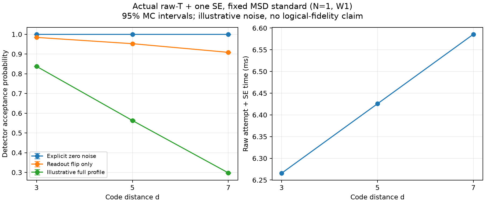

# Distance-dependent raw-T acceptance

Historical direct-injection control. The default protocol is now small d3 injection
followed by ordinary growth; see [the current report](SMALL_INJECTION_GROWTH.md).


Historical two-round result, superseded for normal execution by
[the distance-round protocol](RAW_T_DISTANCE_ROUNDS.md). These numerical results
remain unchanged and describe R=2 at every distance. Exact original reproduction
uses commit `ad33f65`; the current runner requires the explicit historical
`raw_t_two_round_control.json` plan and labels its output as a control.

## Correction and scope

The earlier odd-distance surface-code family generated the correct local
postselection predicates, but did not implement their noisy probability producer.
Only the d3 implementation supplied that calculation. The generic API now
calculates a new probability for the supplied distance and actual physical trace;
it does not reuse a d3 scalar or assume acceptance one under noise.

```python
from modules.codes.rotated_surface import DirectRawTPostselection as RawTPostselection

protocol = RawTPostselection(distance=5, extra_rounds=1)
# Compile, bind and expand using the caller-owned device, homes, world and time.
port = protocol.acceptance_port(
    sequence, device, noise_params=noise_profile,
    method="auto", shots=262144, seed=20261024, batch_size=65536,
)
p_accept = port.outcome("accepted").probability
portable_document = port.to_dict()  # nadit.event_probability/1
```

The model is binary detector acceptance. An accepted raw state can still contain
a logical error. The final temporal boundary remains open after the last SE.
Physical loss is retained as separate evidence, not multiplied into acceptance or
treated as heralded rejection without a corresponding protocol. Noisy accepted
state fidelity, coherent effects, leakage and correlated/common-mode noise are
outside this calculation.

## Fixed experiment

`raw_t_acceptance_plan.json` freezes d=3,5,7, N=1, W1 in the existing six-patch
world, with one injection round and one additional full SE round. Other patches
remain occupied spectators. The usual lower storage/gate half-plane, upper
readout half-plane and 50 um gap remain unchanged. Measurement is 100 us, result
processing 0 us, and each SLM/AOD transfer 100 us; all other reference values are
unchanged. This is not a simultaneous multi-factory production experiment.

Each distance uses one physically validated compiled trace with three explicit
noise controls:

1. Zero noise: all detectors must pass exactly; acceptance is one for every d.
2. Readout-only flips at p=0.001: compare against the independent closed form below.
3. Unmodified `modules/physical_compiler/cost_params/noise_illustrative.json`:
   gate, reset, readout, movement and exposure channels on the actual trace.

The third profile is illustrative, not calibrated hardware. Its resolved
parameters and hash are saved, including loss parameters excluded from the
binary acceptance model. The current T2 implementation acts on idle and selected
transport intervals, not busy gate/reset/measurement intervals.

At most 20 detectors use exact exclusive-channel XOR convolution. Larger noisy
vectors use 262,144 independent trials with seed 20261024 and batches of 65,536.
The sampler retains exclusive alternatives inside a channel, independence across
channels and cancellation of multiple faults. It handles detector vectors wider
than 64 bits. A validated empty effective fault set returns probability one
exactly without allocating an exponential table. Wilson 95% intervals describe
sampling uncertainty for the fixed model, not uncertainty in hardware calibration.

## Independent readout calculation

Let M=d^2-1 be the number of checks per round, B the first-round checks known to
be deterministic from the actual prepared product seed, K=M-B, and R the total
number of rounds. Acceptance requires no readout flips on each deterministic
check and identical flip values across all rounds on each remaining check:

`P_accept = (1-p)^(R B) * ((1-p)^R + p^R)^K`.

B is obtained from the actual check/seed intersection. It is not assumed to be
`(d-1)^2`. Independently checked counts are:

| d | M | B | K | Detectors for R=2 |
|---|---:|---:|---:|---:|
| 3 | 8 | 4 | 4 | 12 |
| 5 | 24 | 8 | 16 | 32 |
| 7 | 48 | 20 | 28 | 68 |
| 9 | 80 | 32 | 48 | 112 |

The d9 row is a structural check, not a completed physical-noise benchmark.
More checks and a different trajectory can change acceptance even when every
per-operation noise parameter is unchanged. This does not establish that larger
d has worse accepted logical-state fidelity; that is a separate missing output.

## Reproduction and artifacts

The completed 2026-10-24 run produced the following results under the unchanged
illustrative noise profile:

| d | Raw + SE device time (us) | Acceptance | 95% interval | Method |
|---|---:|---:|---:|---|
| 3 | 6265.635 | 0.837316296 | exact | XOR convolution |
| 5 | 6425.635 | 0.562873840 | [0.560974098, 0.564771740] | 262,144 MC trials |
| 7 | 6585.635 | 0.297599792 | [0.295852572, 0.299352944] | 262,144 MC trials |

The control results were:

| d | Zero noise | Readout-only estimate | Readout-only analytic reference |
|---|---:|---:|---:|
| 3 | 1 (exact) | 0.984123386 (exact) | 0.984123386 |
| 5 | 1 (exact) | 0.952316284 | 0.953126177 |
| 7 | 1 (exact) | 0.908462524 | 0.908445869 |

The d5 readout-only reference lies just above its Wilson upper endpoint
0.953125421 (about 1.96 standard errors from the sampled estimate). This is one
finite-sample interval noncoverage, retained without changing the seed or shot
budget. All analytic controls pass the predeclared six-standard-error numerical
check; the exact d3 readout result agrees to floating-point precision. Sampling
does not certify 95% coverage for every individual fixed run.

The reduction in acceptance reflects the complete circuit's additional error
opportunities and checks under this profile. This run does not separately
attribute the reduction to each operation type, optimize the injection policy,
or estimate the accepted-state error. The separately reported whole-world
all-atom survival probabilities are 0.9711220, 0.9067579 and 0.8120704, respectively;
they are not folded into the detector acceptance values above.



The compact checked-in [results](results/raw-t-distance-acceptance-20261024.json)
retain the frozen source/noise hashes, counts, methods and intervals. Full
per-distance worlds, validated physical traces and nine probability ports are in
`modules/physical_compiler/artifacts/msd-raw-t-distance-20261024/` (ignored local
artifacts). This run's source manifest hash is
`a5e4a409962907a6416b549c2a9e58e2d45e5007ad5e04ce2b67cb48e55e1fbd`;
its unmodified noise file hash is
`58094b9b6e317ccf9973e7dbd940c90f13cb593e1b465c752b2a757a7257869c`.

Run in this checkout with its physical compiler source first on PYTHONPATH:

```powershell
$env:PYTHONPATH="$PWD\modules\physical_compiler\src;$PWD"
python -m experiments.msd.raw_t_acceptance --plan experiments/msd/raw_t_two_round_control.json --output output/raw-t-distance
python -m experiments.msd.raw_t_acceptance --output output/raw-t-distance --plot-only
```

Output directories and JSON files are exclusive-create. The runner freezes
source/plan/noise fingerprints, enforces an atom limit, and rejects source changes
during calculation. It saves the complete world, admitted physical result,
three portable probability ports and a compact summary for each d. Device time
and host calculation time are kept separate. Analytic controls are checked
before a case is marked complete.

## Verification

Focused pre-change baselines passed (36 existing d3 probability/world tests,
and 105 d3/generic component tests). The complete affected suite after the change
passed **661 tests** with:

```powershell
python -m pytest modules/codes experiments/msd/tests -q
```

Ruff lint/format checks and strict mypy passed for the changed production paths;
new tests also passed lint/format checks. No physical-compiler source was changed,
so its unrelated full test suite was not repeated. The shared engine's existing
d3 consumers were included in the full codes run. New evidence covers actual
T-gate admission, spectator projection, exclusive channel alternatives, fault
cancellation, masks above 64 bits, fixed-seed sampling, confidence intervals,
strict source/distance/detector admission, delayed results and physical gaps.

An independent [saved-result audit](results/raw-t-distance-verification-20261024.json)
revalidated all three full physical traces and replay endpoints, then checked all
nine portable ports against their recorded source/device/noise/channel hashes.
It recomputed the d3 exact probability with an independent Walsh-characteristic
formula, and checked the d5/d7 accepted counts and Wilson intervals independently.
The audit performed no compilation or resampling. Its reusable local script is
`modules/physical_compiler/artifacts/msd-raw-t-distance-20261024/verify_endpoint.py`.

Implementation commits are `05853fb` (shared detector engine), `bfcb832`
(distance-specific producer and protocol interface), and `3336b55` (additional
T-checkpoint and spectator tests). Source fingerprints, rather than commit dates,
identify the exact files used by the numerical run. The unrelated local
`agent.md` edit remains outside these commits.

## Logical-compiler handoff

The consumer may inspect a binary port's `model.kind`, `model.parameters`,
`model.evidence.estimator`, and accepted/rejected outcomes. Cache keys must include
the actual source, distance, extra rounds, device, world geometry, timing and
noise fingerprints. Retry costs also require the actual release/reset and
reinitialization policy; `1/P_accept` alone is not a complete factory schedule.

The separately developed fast compiler currently supports d3 and consumes a
joint acceptance/preparation-class table. This binary port cannot replace that
table: accepted class sampling and physical correction execution remain missing
for generic distances. This change supplies the previously absent acceptance
calculation without claiming larger-distance factory integration is complete.
