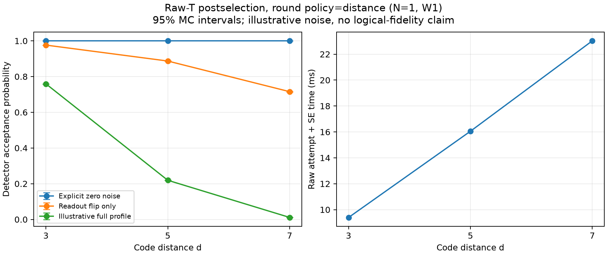

# Raw-T postselection with d total SE rounds

Historical direct-injection control. The default protocol is now small d3 injection
followed by ordinary growth; see [the current report](SMALL_INJECTION_GROWTH.md).


The normal postselection protocol is now raw-T (including its first SE) plus
d-1 ordinary SE rounds. The raw-T primitive is unchanged. The earlier R=2
[results](RAW_T_ACCEPTANCE.md) are historical controls, not the new default.

| d | Raw rounds | Additional SE rounds | Total rounds | Results | Detectors |
|---|---:|---:|---:|---:|---:|
| 3 | 1 | 2 | 3 | 24 | 20 |
| 5 | 1 | 4 | 5 | 120 | 104 |
| 7 | 1 | 6 | 7 | 336 | 308 |

## Interfaces and caches

```python
from modules.codes.rotated_surface import DirectRawTPostselection as RawTPostselection

protocol = RawTPostselection(distance=5)  # total_rounds=5, extra_rounds=4
template = protocol.compile(device, home_sites=homes, origin=origin, aod_id=aod)
sequence = template.bind(binding).expand(context)
port = protocol.acceptance_port(sequence, device, noise_params=noise_profile,
                                shots=262144, seed=20261024, batch_size=65536)
```

Normal `extra_rounds` overrides must agree with d-1. A deliberate historical
control can use `RawTPostselection(5, extra_rounds=1,
round_policy="explicit_control")`; this does not become a normal factory profile.
Version-2 templates and probability metadata identify distance, policy and actual
rounds. New source/trajectory identities prevent probability-cache reuse across
different observation horizons.

The code-owned d3 factory recipe explicitly carries `extra_rounds=2` through
`ResourcePreparation.parameters` into logical preparation calls. The physical
backend reserves 24 results. Fast profile schema `/2` verifies the call, source
result count and joint canonical-preparation port agree on version 2 and R=3.
Old `/1` profiles and two-round ports are rejected. Fast calibration must be
regenerated from a real R=3 source. The fast factory remains d3-only; generic
d5/d7 binary acceptance ports do not imply generic factory canonicalization.

## Frozen comparison

The new plan retains N=1, W1, all six patches, the lower gate/storage half-plane,
upper readout half-plane and 50 um gap. Measurement=100 us, result processing=0,
SLM/AOD load/store=100 us; every other device parameter is unchanged. The
illustrative noise file, 262,144 MC trials, seed 20261024 and batch size 65,536
are unchanged. d3 uses exact convolution (20 detectors); d5/d7 use MC with
Wilson 95% intervals. Zero-noise and readout-only controls reuse the same trace.

The independent readout formula is
`(1-p)^(R B) * ((1-p)^R + p^R)^(M-B)`, with R=d, M=d^2-1 and B=4/8/20.
The calculation retains the actual inter-round physical schedule and full world.

Per-attempt resources include injection/reset, every SE, return transport and
result availability. Independent-repeat expectations divide the attempt cost by
its acceptance probability, with reciprocal probability bounds for the reported
interval. They exclude canonicalization and downstream factory work. Whole-world
atom-time includes the five spectator patches; participant atom-time is also
reported separately. Physical loss is separate, accepted-state error remains
unknown, and R=d is the selected temporal standard rather than a fault-distance
proof for this injection.

## Results under the unchanged illustrative noise

| d | Acceptance | 95% interval | Attempt time (ms) | Expected attempts | Expected time per accepted raw (ms) |
|---|---:|---:|---:|---:|---:|
| 3 | 0.759306464 | exact | 9.394452 | 1.316991 | 12.372412 |
| 5 | 0.219215393 | [0.217635791, 0.220803225] | 16.052087 | 4.561723 | 73.225184 |
| 7 | 0.011154175 | [0.010759245, 0.011563432] | 23.029722 | 89.652531 | 2064.672899 |

The d5/d7 accepted counts are 57,466 and 2,924 of 262,144 trials. The corresponding
95% intervals for expected raw-resource time are [72.698610, 73.756653] ms and
[1991.599313, 2140.458988] ms. These intervals capture Monte Carlo uncertainty
under the chosen profile, not uncertainty in device calibration or output quality.

| d | Participant / retained world atoms | Attempt movement (atom um) | Attempt participant spacetime (atom ms) | Expected accepted participant spacetime (atom ms) | Whole-world visited bbox (um^2) |
|---|---:|---:|---:|---:|---:|
| 3 | 17 / 102 | 6246.726 | 159.706 | 210.331 | 70000 |
| 5 | 49 / 294 | 38370.699 | 786.552 | 3588.034 | 140000 |
| 7 | 97 / 582 | 125829.855 | 2233.883 | 200273.271 | 234000 |

World atom-time is six times participant atom-time in this fixed single-active-
patch experiment. The bbox uses actual occupied/visited coordinates, not the
unbounded readout area. The JSON also reports transport time, idle atom-time,
loads/stores, rotations, resets, measurements and whole-world CZ illumination.
Whole-world illumination counts are not logical two-qubit gate counts.

For comparison, the historical two-round acceptance was
0.837316296 / 0.562873840 / 0.297599792 and attempt time was
6.265635 / 6.425635 / 6.585635 ms at d=3/5/7. The new calculation confirms both
longer attempts and more rejections under the same model. It does not establish
that larger distances have worse accepted logical fidelity.



The [compact results](results/raw-t-distance-rounds-20261024.json) retain all
per-attempt and expected accepted resource values. Full artifacts are in
`modules/physical_compiler/artifacts/msd-raw-t-distance-rounds-20261024-final/`.
Source manifest hash:
`5894b2718c1a4604271c2e63371ca216a5dd776e9060c25015ddbc9ac26ee2f8`.
Noise file hash (unchanged):
`58094b9b6e317ccf9973e7dbd940c90f13cb593e1b465c752b2a757a7257869c`.

## Rebuilt logical probability cache

The actual MSD d3 illustrative joint cache is
`modules/physical_compiler/artifacts/msd-d3-r3-canonical-cache-20261024-final/d3.illustrative.canonical_preparation.port.json`.
It has 16 accepted correction classes and one rejection outcome; each accepted
class has probability 0.04745665397609434, summing to 0.7593064636175094. Its
physical trace, device, noise and horizon match the generic d3 benchmark exactly.
It uses the legacy d3 correction convention expected by the existing consumer;
generic correction metadata is not relabeled as that convention.

A separate full reference -> profile -> fast execution test completed with
15 raw preparations, three parts per raw, 45 profile entries and one output.
It uses explicitly zero noise to verify the interface and cache, not to produce
the noisy table above. Files are in
`modules/logical_compiler/artifacts/raw-t-r3-fast-smoke-20261024-final/`, including
`run_smoke.py`, `configuration.json`, `noise.json`, `profile-v2.json` and its
verification report. The profile schema is `/2`; R2 and old-schema inputs are
explicitly rejected. Calibration preserves the actual theory/proxy consumption
model and rejects cross-model cache use rather than changing its identity.

## Reproduction

```powershell
$env:PYTHONPATH="$PWD\modules\physical_compiler\src;$PWD"
python -m experiments.msd.raw_t_acceptance --output output/raw-t-distance-rounds
```

The runner saves the full worlds, admitted physical traces, nine probability
ports and per-distance resource statistics under frozen source/plan/noise hashes.
It rejects a source change during calculation. Historical files are retained.

## Verification

The integrated runtime change is commit `b76ce8b`, on the logical/compiler merge
`ee57888` (logical snapshot `852fd73`). The experiment code/configurations and
compact results are committed separately. The original user edit to `agent.md`
is preserved outside these commits.

The integrated logical/component baseline passed 96 selected tests before the
protocol change. The broad affected sweep covered 1,487 tests: the regular sweep
reported 1,480 passed and six failures; the expensive physical-noise full-factory
regression was run separately and passed in 631.76 seconds. The six failures were
test expectations affected by the approved change, not relaxed production guards:

- Four toy-case serialization snapshots gained explicit empty parameter fields.
  Removing only those fields exactly restores each old full-document hash;
  all five tests in that module passed after recording the new serialization.
- Two physical parallel tests retained R=2 part counts/timing. They now verify
  R=3 and the measured added-SE cost while keeping the old prefix baseline.
  Both complete modules passed, 31 tests total.

No further complete sweep was repeated after these test-only migrations. The
remaining 1,480 cases and the physical-noise regression passed against the final
runtime sources. Changed production paths passed strict mypy (21 files), and
all 47 changed/new Python files passed formatting and correctness/import lint
checks. The existing `build_components.py` exporter has 17 pre-existing strict
mypy diagnostics, checked against its baseline and left outside this change.
Long string-literal line-length warnings under the physical compiler's stricter
style rules are not functional failures and were not used to invalidate frozen
scientific data.

The [regression record](results/raw-t-distance-rounds-regression-20261024.json)
separates the broad sweep, targeted repairs and expensive physical-noise test.

The first numerical endpoint passed an independent
[1,049-check audit](results/raw-t-distance-rounds-independent-audit-20261024.json),
including full semantic replay, regenerated noise/channel hashes, independent
d3 Walsh inversion and independently calculated Wilson intervals. After the
fast-calibration compatibility fix, the final three traces, three worlds and nine
full ports were byte-identical. The
[final equivalence audit](results/raw-t-distance-rounds-verification-20261024.json)
verified this identity, all resource values and current source hashes in 543
additional checks; it explicitly reuses the earlier mathematical validation.

The actual illustrative d3 joint cache and the separate zero-noise full-to-fast
run have their own [joint-cache verification](results/raw-t-d3-canonical-cache-verification-20261024.json)
and [fast verification](results/raw-t-r3-fast-verification-20261024.json).
No hardware execution or accepted-state error estimate is claimed.
