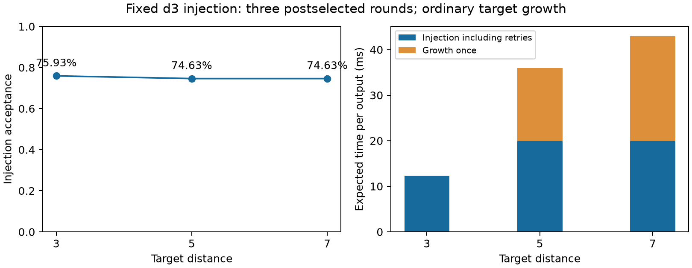
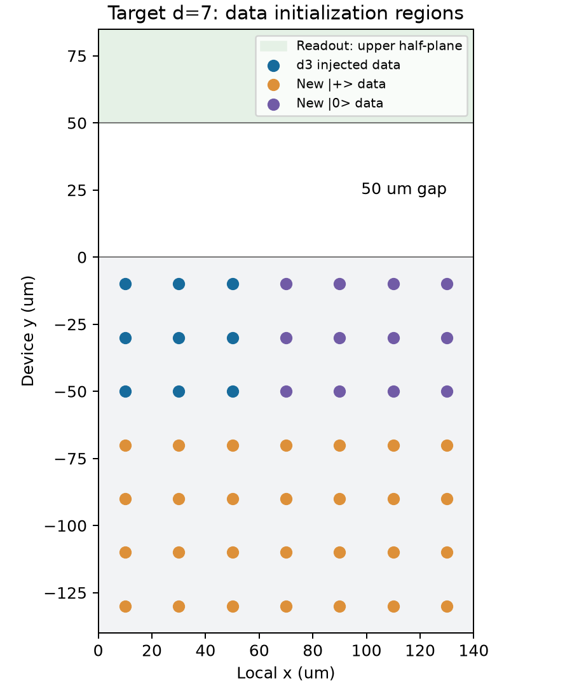

# Fixed d3 injection followed by ordinary code growth

Historical standard/1 results with 100 us transfers, source revision `75fdb85`.
The current 10 us standard and complete replay are documented
[here](TRANSFER_10US_ANIMATION.md).

The default generic raw-T path now injects at distance three and then enlarges
the patch. Target-distance checks are decoded, never postselected. This replaces
the all-target-distance postselection experiment; old results remain historical
controls through `DirectRawTPostselection`.

## Frozen experiment and results

The experiment preserves the established layout, six allocated patches, one
pipeline, upper readout/lower storage half-planes, 50 um gap, measurement 100 us,
information processing 0 us, LOAD/STORE 100 us, and the unchanged illustrative
noise file. The injected subpatch touches the target's upper physical edge.
Only its 17 atoms participate in injection. All target and spectator atoms remain
in the physical world and resource accounting.

Default postselection retains **three d3 SE rounds** (20 detectors). The two-round
Li timing variant is available as `injection_rounds=2`, but is not used in this
table. After acceptance, d5/d7 perform respectively five/seven ordinary target SE
rounds, including the deformation round. Target d3 requires no deformation.

| Target d | Injection acceptance | Injection attempt (ms) | Growth once (ms) | Expected total (ms/output) | Unpostselected raw-T (ms) |
| --- | ---: | ---: | ---: | ---: | ---: |
| 3 | 0.7593064636175094 | 9.394452 | 0 | 12.372412 | 3.136817 |
| 5 | 0.7463101188333865 | 14.861898 | 16.051087 | 35.964925 | 21.010387 |
| 7 | 0.7463101188333865 | 14.861898 | 23.028722 | 42.942560 | 27.988022 |

These are exact independent-Pauli/readout acceptance calculations on 20 injection
detectors, with separate exact-zero and analytic readout-only checks. No confidence
interval is needed for this numerical convolution. They are not calibrated
hardware probabilities, physical-loss yield, or accepted-output logical accuracy.

The d3-to-d5 difference is physical scheduling: unused target atoms constrain AOD
intersections. Each injection round needs more transport groups and three readout
batches instead of one. The d5 and d7 injection geometries/active exposure match,
so their acceptance is identical. The compiler does not force numerical equality.
Naively reusing an isolated d3 template fails full-world ghost-pickup validation;
planning now includes the stationary outer atoms.

Expected additive cost is **injection cost / acceptance + growth cost**, since
growth runs once after the accepted attempt. There is no early-abort optimization
inside a small-patch attempt. No extra retry-cleanup cost is invented: the next
attempt already resets every injection carrier. The growth phase initializes its
new data only when entered.

| Target d | Target / full-world atoms | Expected full-world atom-us/output | Movement atom-um/output | Expected transport time (ms) |
| --- | ---: | ---: | ---: | ---: |
| 3 | 17 / 102 | 1,261,986.03 | 8,226.88 | 11.86010 |
| 5 | 49 / 294 | 10,573,687.95 | 46,494.61 | 33.99774 |
| 7 | 97 / 582 | 24,992,569.91 | 133,953.76 | 40.72137 |

The JSON includes per-operation exposure, idle/busy atom time, trajectories,
footprints and raw versus postselected costs. Global CZ illumination atom-events
include spectators and must not be confused with the number of interacting pairs.
Whole-world allocation includes five other idle patches; this is preparation
resource accounting, not a complete six-patch distillation output measurement.



The representative layout below shows data only; dedicated syndrome atoms are
included in the compiled worlds and source circuits. The blue region stays alive
while the added orange/purple regions are initialized.



## Actual APIs and decoder scope

- `get_component("raw_t", d)`: one d3 injection SE, then ordinary growth. The d3
  primitive is unchanged. Larger-d sources contain exactly one seed T. They do
  not reset the injected data during enlargement.
- `RawTPostselection(d)`: staged version 3. `bound.expand(context)` returns only
  injection. `bound.grow(received_injection, context)` requires an accepted event
  whose actual measurement results are available; pending/rejected events fail.
  The result-ID allocation, input world, source and binding are checked.
- `grown.with_results(bits).decode(at_us)` returns an explicit data Pauli frame.
  Growth has no acceptance conditions. Nonzero syndromes are normal decoder input.
  The caller must retain the frame through logical gates or physically apply it.
- The probability port's accepted branch is an intermediate `continue`, not a
  target-state delivery. Version-3 admission checks stage/template and resolved
  noise identity, and rejects historical all-d caches. The old d3 fast factory
  requires a joint canonical-class distribution and correctly rejects this binary
  port. Its existing d3 three-round behavior remains valid; no d5/d7 full factory
  backend is claimed by this component experiment.

Growth uses phenomenological MWPM with configurable positive data/readout weights
and open temporal boundaries. The first target syndrome is a gauge reference;
the decoder estimates measurement faults in that reference before canonicalizing
it. Equal default weights do not alter the physical noise model. This is an
implemented ordinary decoder, but not a circuit-level calibrated decoder, an FT
distance proof, or an accepted-output LER calculation. Pre-reference and terminal
fault exposure remains a quality limitation. Physical loss is still reported
separately rather than silently converted into rejection or a Pauli correction.

This is a rotated-code adaptation of the small-injection/growth principle in
[Li 2015](https://arxiv.org/abs/1410.7808), not the paper's exact unrotated circuit
or an inheritance of its error coefficients. See [ADR 0055](../../docs/decisions/0055-small-injection-then-growth.md).

## Reproduction and verification

From this checkout in PowerShell, with the existing Python environment:

```powershell
$env:PYTHONPATH="$PWD\modules\physical_compiler\src;$PWD"
python -m experiments.msd.small_injection_growth --output modules/physical_compiler/artifacts/my-small-growth-run
python -m experiments.analysis.plot_raw_t_growth modules/physical_compiler/artifacts/my-small-growth-run/summary.json --output experiments/msd/results/figures
```

The output directory must be new. The committed
[plan](small_injection_growth_plan.json) fixes the allocation, rounds and noise.
The runner rejects a source change during execution and never fabricates runtime
acceptance bits to compile its conditional cost references.

- Focused baseline: 61 tests passed before implementation.
- Updated generic component suite: 143 tests passed.
- Final affected integration run: **909 passed** across all code modules, MSD
  tests and selected logical fast-compiler consumers.
- Strict mypy passed on 10 changed runtime files; Ruff formatting and selected
  correctness/import/style checks passed on the changed Python scope.
- Independent saved-result validation rechecked all **8** physical segments,
  entry/exit equality, unchanged noise, current source identity, and the retry
  formula. X/Y/Z growth channels were checked at d5/7/9, persistent single data
  faults and readout blips at d5/7, and pending/reject/cache guards at d3/5/7.

Tracked [results](results/small-injection-growth-20261024.json) and
[independent verification](results/small-injection-growth-verification-20261024.json).
Full trajectories, worlds, noise reports and probability caches are in
`modules/physical_compiler/artifacts/msd-small-injection-growth-20261024/`.
The exact runtime source hash is
`272582385f4456d9cc66a049ab67a5534e788264983d8e3d50560dfd7f10278f`.

No hardware execution, noisy logical-output certification, N-pipeline rerun, or
two-level distillation result is claimed by this single-preparation experiment.
